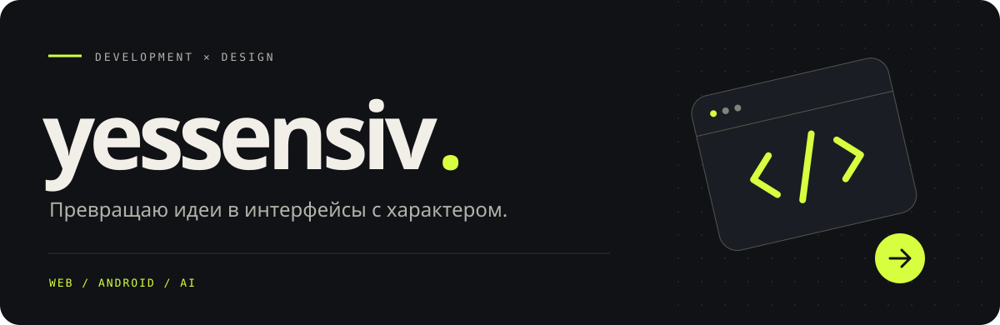

<h2 align="center">Hi, I'm Timush</h2>

---

### 01 / Behind the code

I build web experiences with **Next.js and TypeScript**, explore Android with **Kotlin**, and make AI tools with **Python**. My projects span education, document assistants and websites with motion.

### 02 / My toolkit

Web development &nbsp; / &nbsp; Android &nbsp; / &nbsp; AI assistants Motion with GSAP & Lenis

### 03 / Things I've built

<table>
<tr>
<td width="50%" valign="top">
<h3><a href="https://github.com/yessensiv/ENT-MATH">ENT-MATH ↗</a></h3>

Mathematics for grades 5–11 and ENT preparation in Kazakhstan.

 

</td>
<td width="50%" valign="top">
<h3><a href="https://github.com/yessensiv/san-portfolio">SAN Portfolio ↗</a></h3>

A portfolio exploring motion, smooth scrolling and visual detail.

 

</td>
</tr>
<tr>
<td width="50%" valign="top">
<h3><a href="https://github.com/yessensiv/docmind-telegram">DocMind ↗</a></h3>

A Telegram AI assistant for document summaries and questions.

 

</td>
<td width="50%" valign="top">
<h3><a href="https://github.com/yessensiv/flow-downloader">Flow Downloader ↗</a></h3>

Exploring Android development through a downloader project.

 

</td>
</tr>
<tr>
<td width="50%" valign="top">
<h3><a href="https://github.com/yessensiv/dentalux">Dentalux ↗</a></h3>

A dental clinic website demo built with Next.js.

</td>
<td width="50%" valign="top">
<h3><a href="https://github.com/yessensiv/zaga-zaga">Zaga Zaga ↗</a></h3>

An unofficial design concept exploring visual direction.

</td>
</tr>
</table>

<a href="https://github.com/yessensiv?tab=repositories">All projects ↗</a>

### 04 / GitHub in numbers

### 05 / Milestones

Commits · stars · followers · pull requests · repositories

### 06 / Contribution landscape

Refreshed daily with GitHub Actions.

More language & activity insights

 

---

Code. Learn. Build. Repeat.

